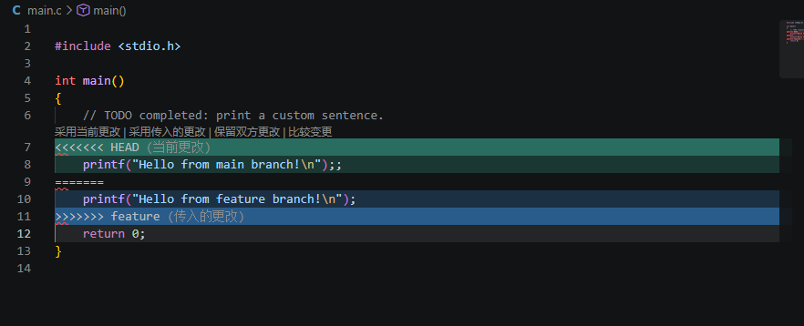
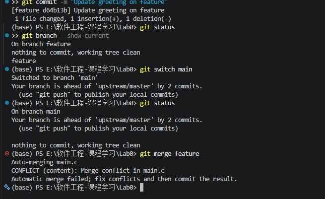
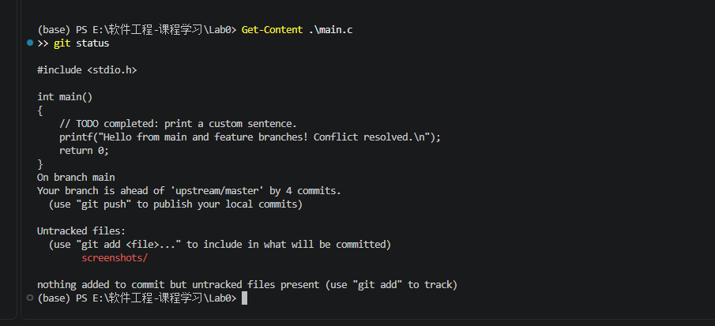
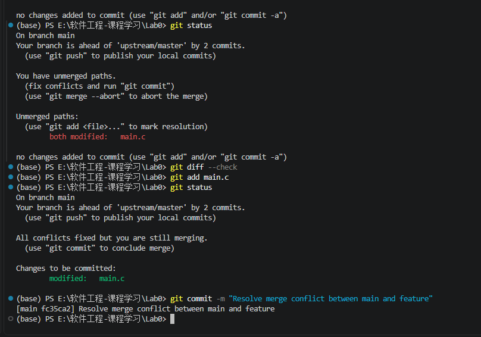
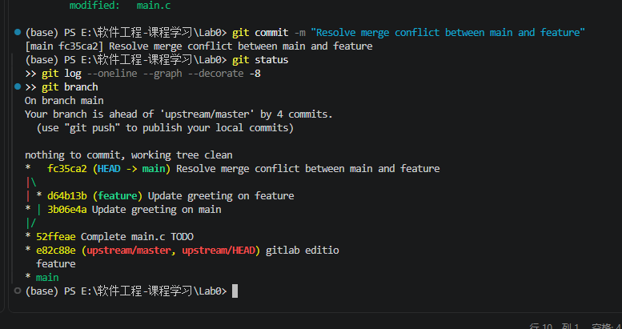

# Lab0：GitLab 实验报告

## 一、实验目的

1. 掌握 Git 的安装、配置和基本使用方法。
2. 理解工作区、暂存区和本地仓库的作用。
3. 学习代码提交、分支创建、分支切换与分支合并。
4. 掌握 Git 合并冲突的处理方法。
5. 理解版本控制在软件开发、科研项目和团队协作中的作用。

## 二、实验环境

- 操作系统：Windows
- 终端：Windows PowerShell
- 编辑器：Visual Studio Code
- 版本控制工具：Git
- 课程模板仓库：`https://gitlab.etao.net/chenbo/gitlab.git`
- 个人作业仓库：`https://gitlab.etao.net/phar26/YLH`

## 三、实验步骤

### 1. 检查与配置 Git

使用 `git --version` 检查 Git 是否安装成功，并通过 `git config --global user.name` 和 `git config --global user.email` 配置提交作者信息。

使用以下命令查看配置：

```powershell
git config --global --get user.name
git config --global --get user.email
```

### 2. 克隆课程模板

使用 `git clone` 将课程模板下载到本地，在 VS Code 中打开仓库，查看 `main.c`、`Makefile` 和 `README.md` 等文件。

### 3. 完成 main.c 中的 TODO

修改 `main.c` 中的输出语句，并提交修改：

```powershell
git add main.c
git commit -m "Complete main.c TODO"
```

使用 `git status` 和 `git log --oneline` 检查提交结果。

### 4. 创建 feature 分支

使用以下命令创建并切换到 `feature` 分支：

```powershell
git switch -c feature
git branch
```

通过 `git branch` 确认本地存在 `main` 和 `feature` 两个分支。

### 5. 在两个分支上分别修改代码

在 `main` 分支中修改 `main.c` 的输出语句并提交：

```powershell
git switch main
git add main.c
git commit -m "Update greeting on main"
```

随后切换到 `feature` 分支，对同一位置进行不同的修改并提交：

```powershell
git switch feature
git add main.c
git commit -m "Update greeting on feature"
```

两个分支分别保存了不同的修改，为后续的合并冲突实验做好准备。

### 6. 合并分支并处理冲突

切换回 `main` 分支，执行：

```powershell
git switch main
git merge feature
```

由于两个分支修改了同一位置的代码，Git 无法自动判断应该保留哪一方的修改，因此产生了内容冲突。

在 VS Code 中打开 `main.c`，删除 Git 添加的冲突标记，保留最终代码。然后执行：

```powershell
git add main.c
git commit -m "Resolve merge conflict between main and feature"
```

最后使用以下命令检查合并结果：

```powershell
git status
git log --oneline --graph --decorate -8
```

结果表明，冲突已解决并提交，`main` 分支包含了合并后的代码。

### 7. 实验截图

#### 7.1 main.c 中的合并冲突



#### 7.2 终端中的合并冲突信息



#### 7.3 冲突解决后的代码



#### 7.4 冲突解决后的提交记录



#### 7.5 Git 分支和提交历史



## 四、实验问题与思考

### 1. 之前是否有多人协同开发经历？如果有，使用什么方式分工协作？

请根据自己的真实经历填写。

如果此前没有正式参与过基于 Git 的多人协同开发，可以写：

此前没有正式参与过基于 Git 的多人协同开发。个人项目通常在本地进行编辑和保存，如果需要交换代码，可以通过文件传输的方式完成。这种方式不方便追踪修改历史，也容易出现文件覆盖和版本混乱的问题。

通过本次实验，我了解到 Git 可以通过分支隔离不同的开发任务，并通过提交历史记录每次修改。多人协作时，开发者可以分别完成任务，再将各自的修改合并到共同的分支中。

### 2. 为什么 Git 要设计“暂存—提交”两个步骤？

`git add` 用于选择需要纳入下一次提交的修改，并将其放入暂存区；`git commit` 则把暂存区中的内容保存为一个正式版本。

将暂存和提交分开，可以让开发者自主选择每次提交的内容，避免将无关或尚未完成的修改混在一起。这样可以提高提交内容的可控性，使提交历史更清晰，也更方便后续审查和回溯。

### 3. git branch 和 git branch -a 有什么区别？

`git branch` 默认显示本地分支。

`git branch -a` 显示本地分支和本地已知的远程跟踪分支。

远程跟踪分支记录了本地 Git 对远程分支状态的认知。执行 `git fetch` 可以更新这些信息，因此 `git branch -a` 不一定始终反映服务器上的最新状态。

### 4. Commit Message 规范的主要内容

Commit Message 是描述一次代码提交目的的信息。清晰、规范的提交信息有助于开发者阅读提交历史、定位问题和理解代码变更。

一种常见格式是：

`类型(范围): 简短描述`

常见类型包括：

- `feat`：增加功能。
- `fix`：修复错误。
- `docs`：更新文档。
- `test`：增加或修改测试。
- `refactor`：重构代码。

提交信息应简洁、准确地表达本次修改的目的。对于复杂修改，还可以在正文中说明修改原因和实现方式。

### 5. 语义化版本的主要内容

语义化版本通常采用 `MAJOR.MINOR.PATCH` 的格式。

- MAJOR：存在不兼容的 API 变更时递增。
- MINOR：增加向后兼容的新功能时递增。
- PATCH：进行向后兼容的错误修复时递增。

语义化版本能够帮助开发者理解软件版本之间的差异，并评估升级时可能遇到的兼容性问题。

### 6. 为什么要学习 Git？

Git 不仅用于保存代码历史，也是现代软件开发的重要协作工具。

首先，Git 可以记录每次修改，便于比较不同版本，并在出现错误时回溯到之前的提交。其次，分支可以让开发者独立开发不同功能，降低未完成代码对稳定版本的影响。再次，Git 可以帮助团队整合不同开发者的修改，并通过冲突处理解决相互矛盾的变更。

在科研和人工智能项目中，Git 还可以管理模型代码、配置文件和实验脚本的演变，使开发过程更容易追踪和复现。因此，掌握 Git 有助于提高开发效率、代码管理能力和团队协作能力。

## 五、实验总结

通过本次实验，我学习了 Git 的基本配置、暂存与提交、分支创建与切换，以及分支合并和冲突处理。

在合并冲突实验中，两个分支修改了同一位置的内容，Git 无法自动判断最终结果，因此需要人工解决冲突并提交合并结果。这使我进一步理解了版本控制不仅用于保存历史，也用于管理并行开发中的代码变更。

后续开发中，我会注意保持提交内容清晰、提交信息规范，并在合并分支前检查工作区状态，以减少版本管理错误。

## 六、实验建议（可选）

建议后续实验继续使用 Git 管理代码，并增加更多分支合并与冲突处理示例，帮助初学者理解版本控制的实际应用。